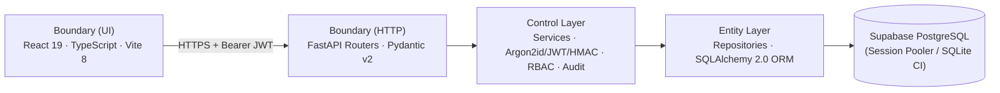

<div align="center">


# PassDown
### Academic Course Archive & Peer Resource-Sharing Platform

*Browse university courses without a login wall, discover admin-verified core materials, share moderated study notes, collaborate in permission-controlled study groups, and fulfill academic resource requests.*

<p>
  <a href="https://passdown-academic-resource-platform.vercel.app/"></a>
  <a href="https://github.com/tanjilhasanemon/PassDown-Academic-Resource-Platform/actions/workflows/ci.yml"></a>
  <a href="https://github.com/tanjilhasanemon/PassDown-Academic-Resource-Platform/actions/workflows/codeql.yml"></a>
  
  
</p>

<p>
  
  
  
  
  
  
  
</p>

<p>
  <a href="https://passdown-academic-resource-platform.vercel.app/"><strong>🚀 Live Deployment</strong></a>
  &nbsp;·&nbsp;
  <a href="https://passdown-academic-resource-platform.vercel.app/api/docs"><strong>📘 OpenAPI Swagger Docs</strong></a>
  &nbsp;·&nbsp;
  <a href="https://github.com/tanjilhasanemon/PassDown-Academic-Resource-Platform/wiki"><strong>📚 12-Section GitHub Wiki</strong></a>
  &nbsp;·&nbsp;
  <a href="https://github.com/tanjilhasanemon/PassDown-Academic-Resource-Platform/issues"><strong>🐞 Issues &amp; Feedback</strong></a>
</p>

</div>

---

## 📌 Academic Context

* **Course:** `CSE 451` — Software Engineering
* **Institution:** Department of Computer Science & Engineering, **Independent University, Bangladesh (IUB)**
* **Architecture:** Entity–Control–Boundary (**ECB**) & Strict 4-Tier Layered Design
* **UI System:** **Swiss Academic Archive** (Light Archival Stone & Carbon Dark Themes — engineered for Jakob Nielsen's 10 Usability Heuristics)

---

## ✨ Key Platform Capabilities

| Capability | Description |
|---|---|
| **Public Course Directory (`FR-03`)** | Browse 11+ seeded IUB courses across 5 departments (`CSE`, `MAT`, `BBA`, `PHY`, `ENG`) with instant `?q=` search (`/` shortcut), department/level (`100`–`400`) filters, removable Active Filter Chips, and Grid/Table toggle. |
| **Core Materials & Moderated Contributions (`FR-05`–`FR-09`)** | Separates admin-curated **Core Materials** from student **Contributions** (`pending -> approved \| rejected`) with one-click **Copy Link**, strict `http(s)://` validation, and owner-only pending edit/withdrawal. |
| **Material Requests (`FR-10`–`FR-12`)** | Structured board for missing course resources or new-course proposals (`open -> fulfilled`) with owner/admin fulfillment controls. |
| **Collaborative Study Groups (`FR-12`)** | Course-linked group workspaces enforcing granular per-member permissions (`can_create`, `can_edit`, `can_assign`) and shared resource boards. |
| **Defense-in-Depth Security (`FR-01`–`FR-02`)** | **Argon2id** password hashing + server-side pepper, **15-minute HS256 JWT** access tokens, **7-day rotating `HMAC-SHA256` refresh tokens** (`user_session`), 5-attempt account lockout, and active device session revocation. |
| **Admin Governance & Audit Hub** | Pending moderation queue, Course/Material CRUD, User search/ban/role/unlock (with self-demotion protection), Security Overview, and CSV-exportable Activity Audit Logs. |
| **Nielsen's 10 Usability Heuristics** | Persistent Breadcrumbs (`H3`), Quick Orientation Strip (`H6`/`H10`), styled `ConfirmModal` delete guards (`H5`), plain-language error recovery (`H9`), and a global `?` Quick Help & Keyboard Shortcuts modal (`H7`/`H10`). |

---

## 🏛️ Architecture — Entity–Control–Boundary (ECB)



| ECB Layer | Directory | Core Technologies |
|---|---|---|
| **Boundary (Presentation)** | `frontend/src/` | React 19, TypeScript 7, Vite 8, React Router 7, Axios, Lucide React |
| **Boundary (HTTP & DTOs)** | `backend/api/v1/`, `backend/schemas/` | FastAPI, Pydantic v2, HTTP Security Headers Middleware |
| **Control (Business & Security)** | `backend/services/`, `backend/core/`, `backend/dependencies/` | Argon2id (`argon2-cffi`), PyJWT, Keyed `HMAC-SHA256`, OAuth2 Scopes |
| **Entity (Persistence)** | `backend/models/`, `backend/repositories/`, `backend/alembic/` | SQLAlchemy 2.0, `psycopg[binary]`, Alembic, Supabase PostgreSQL |

---

## 🛡️ Automated Quality, Security & Documentation Gates

Every push to `main` automatically runs **4 GitHub Actions & CodeQL workflows**:

* **Linting & Static Analysis:** `Ruff` (`--select E9,F`) and `TypeScript Strict` (`tsc && vite build`) — **0 errors**.
* **Security Scanning:** `Bandit` (`-ll`) and **GitHub CodeQL** (Python + JavaScript/TypeScript) — **0 open alerts**.
* **Automated Testing:** `Pytest` + `pytest-cov` (**21 automated tests** spanning normal, boundary, invalid `422`, RBAC `401`/`403`, and exceptional cases).
* **Source Code Documentation:** **Sphinx** (`349/349` = `100.0%` Google-style docstrings verified in CI), **TypeDoc** (`frontend/typedoc.json`), and live **OpenAPI Swagger UI** (`/api/docs`).

---

## 📚 CSE 451 Documentation Hub (12-Section GitHub Wiki)

| # | Section | Wiki Page |
|---:|---|---|
| 01 | Software Requirements Specification (SRS v2.0) | [01-Software-Requirements-Specification](https://github.com/tanjilhasanemon/PassDown-Academic-Resource-Platform/wiki/01-Software-Requirements-Specification) |
| 02 | Software Design Specification (SDS v2.0) | [02-Software-Design-Specification](https://github.com/tanjilhasanemon/PassDown-Academic-Resource-Platform/wiki/02-Software-Design-Specification) |
| 03 | Evidence of Trello and Discord Usage | [03-Trello-and-Discord-Usage](https://github.com/tanjilhasanemon/PassDown-Academic-Resource-Platform/wiki/03-Trello-and-Discord-Usage) |
| 04 | Architectural Pattern (ECB & Layered Design) | [04-Architectural-Pattern-ECB](https://github.com/tanjilhasanemon/PassDown-Academic-Resource-Platform/wiki/04-Architectural-Pattern-ECB) |
| 05 | Coding Standards and Guidelines | [05-Coding-Standards-and-Guidelines](https://github.com/tanjilhasanemon/PassDown-Academic-Resource-Platform/wiki/05-Coding-Standards-and-Guidelines) |
| 06 | Source Code Documentation Tools (Sphinx & TypeDoc) | [06-Source-Code-Documentation-Tools](https://github.com/tanjilhasanemon/PassDown-Academic-Resource-Platform/wiki/06-Source-Code-Documentation-Tools) |
| 07 | UI Design (Swiss Academic Archive) | [07-UI-Design](https://github.com/tanjilhasanemon/PassDown-Academic-Resource-Platform/wiki/07-UI-Design) |
| 08 | Nielsen's 10 Usability Heuristics Evaluation | [08-Nielsens-Usability-Heuristics](https://github.com/tanjilhasanemon/PassDown-Academic-Resource-Platform/wiki/08-Nielsens-Usability-Heuristics) |
| 09 | Code Review Tools and Findings | [09-Code-Review-Tools-and-Findings](https://github.com/tanjilhasanemon/PassDown-Academic-Resource-Platform/wiki/09-Code-Review-Tools-and-Findings) |
| 10 | Evidence of Usage of Git and CI/CD | [10-Evidence-of-Git-and-CI-Usage](https://github.com/tanjilhasanemon/PassDown-Academic-Resource-Platform/wiki/10-Evidence-of-Git-and-CI-Usage) |
| 11 | Unit Testing — Test Coverage and Quality | [11-Unit-Testing-Coverage-and-Quality](https://github.com/tanjilhasanemon/PassDown-Academic-Resource-Platform/wiki/11-Unit-Testing-Coverage-and-Quality) |
| 12 | Individual Team Member Contributions | [12-Individual-Team-Member-Contributions](https://github.com/tanjilhasanemon/PassDown-Academic-Resource-Platform/wiki/12-Individual-Team-Member-Contributions) |

---

## 🔑 Pre-Seeded Demo Accounts

| Role | Email | Password | Scope |
|---|---|---|---|
| **Admin** | `admin@passdown.edu` | `Admin1234` | Full Course/Material CRUD, Moderation, User Mgmt, Audit Logs |
| **Student** | `student@passdown.edu` | `Student1234` | Profile/Sessions, Contributions, Requests, Study Group Owner |
| **Student (Limited Group Perms)** | `student3@passdown.edu` | `Student1234` | Demonstrates `can_assign=True`, `can_create=False` RBAC boundary |

---

## 💻 Local Development Setup

### 1. Backend (FastAPI + SQLAlchemy)
```powershell
cd backend
python -m venv .venv
.\.venv\Scripts\python.exe -m pip install --only-binary=:all: -r requirements-dev.txt

# Run Quality Gates, 21 Pytest Tests & Sphinx Docs
.\.venv\Scripts\python.exe -m ruff check --select E9,F .
.\.venv\Scripts\python.exe -m bandit -r api core dependencies models repositories schemas services main.py -ll
$env:PYTHONPATH="."; .\.venv\Scripts\python.exe -m pytest -v --cov=. --cov-report=term-missing --cov-report=html
.\.venv\Scripts\python.exe -m sphinx -b html ../docs/source ../docs/build/html

# Start Development Server (http://127.0.0.1:8000/api/docs)
.\.venv\Scripts\python.exe -m uvicorn main:app --reload --port 8000
```

### 2. Frontend (React 19 + TypeScript + Vite 8)
```powershell
cd frontend
npm.cmd install
npm.cmd run typecheck
npm.cmd run build
npm.cmd run docs
npm.cmd run dev
```

---

## ☁️ Production Deployment (Vercel Services + Supabase)

PassDown deploys as a single unified **Vercel Services** project via root `vercel.json` (`/api/*` → FastAPI `backend/main.py`, `/*` → Vite SPA):
1. Import this repository in **Vercel** with **Root Directory = `./`** and **Application Preset = `Services`**.
2. Set `DATABASE_URL` (Supabase IPv4 **Session Pooler** URI on port `5432`) and a 32+ character `JWT_SECRET` in **Environment Variables**.
3. Deploy — tables and initial IUB seed data initialize idempotently on first boot.

---

## 👥 Project Team (CSE 451 — IUB)

| Role | Name | Student ID | Assigned Scope |
|---|---|---|---|
| **Team Lead (Member 1)** | Tanjil Hasan Emon (`THE`) | `2331024` | `FR-01`–`FR-03` · Auth, RBAC/JWT Security, CI/CD, Deployment & Architecture |
| **Member 2** | Tanjil Sarkar (`TS`) | `2312026` | `FR-04`–`FR-06` · Course Catalog, Filtering, Core Materials & UI/UX Audits |
| **Member 3** | Md Jawad Abdullah (`MJA`) | `2230325` | `FR-07`–`FR-09` · Community Contributions, Moderation Queue & Sphinx Docs |
| **Member 4** | S M Mashraful Islam (`SMMI`) | `2230836` | `FR-10`–`FR-12` · Material Requests, Study Groups, Admin Audit & TypeDoc |

---

<div align="center">
  <sub>Built with care for Independent University, Bangladesh (IUB) · CSE 451 Software Engineering · MIT License</sub>
</div>
