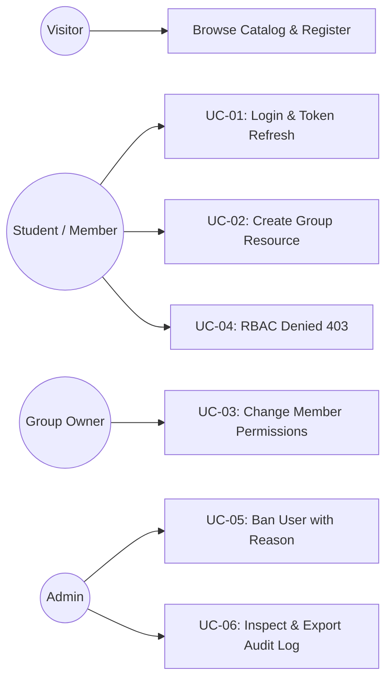
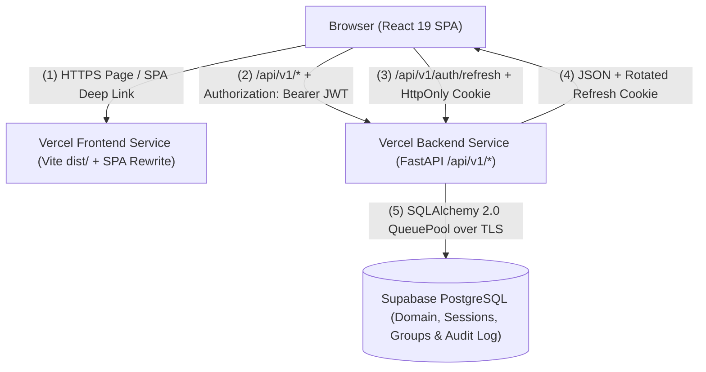
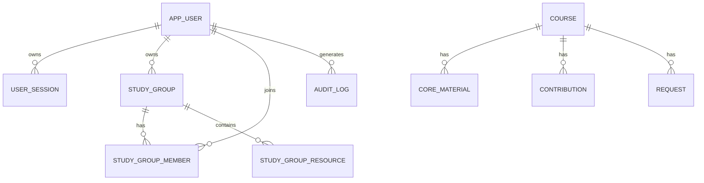
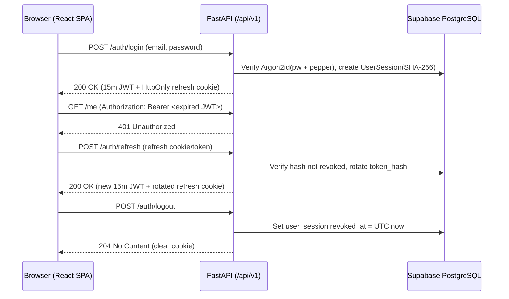

Independent University, Bangladesh  
CSE309 Web Application & Internet  

# Final Project Submission Report

**Submitted by:**  
Name: Tanjil Hasan Emon  
Student ID: 2331024  
Section: 5  
Team Number: Individual  

Project Title: PassDown — University Course Material Archive & Peer Resource-Sharing Platform  
Vercel URL: https://passdown-weld.vercel.app/  
GitHub Repository: https://github.com/tanjilhasanemon/passdown  

**Submitted To:**  
Sayef Reyadh  
Adjunct Lecturer  
Department of Computer Science & Engineering  
Independent University, Bangladesh  

Semester: Autumn 2026  
Date of Submission: 28 November 2026

---

## Table of Contents

- [1. Executive Summary](#1-executive-summary)
  - [1.1 Project overview](#11-project-overview)
  - [1.2 What was built since the mid assessment](#12-what-was-built-since-the-mid-assessment)
  - [1.3 Live links](#13-live-links)
- [Part A. Product Requirements (PRD)](#part-a-product-requirements-prd)
  - [A1. Problem Statement](#a1-problem-statement)
  - [A2. Users and Roles](#a2-users-and-roles)
  - [A3. Goals and Success Measures](#a3-goals-and-success-measures)
  - [A4. Scope and Non-Goals](#a4-scope-and-non-goals)
  - [A5. User Stories](#a5-user-stories)
- [Part B. Software Requirements (SRS)](#part-b-software-requirements-srs)
  - [B1. Introduction](#b1-introduction)
  - [B2. Functional Requirements](#b2-functional-requirements)
  - [B3. Non-Functional Requirements](#b3-non-functional-requirements)
  - [B4. Roles and Permission Matrix](#b4-roles-and-permission-matrix)
  - [B5. Use Cases](#b5-use-cases)
  - [B6. Acceptance Criteria](#b6-acceptance-criteria)
  - [B7. Traceability Matrix](#b7-traceability-matrix)
- [Part C. Technical Design (TDD)](#part-c-technical-design-tdd)
  - [C1. Technology Stack](#c1-technology-stack)
  - [C2. System Architecture](#c2-system-architecture)
  - [C3. Backend and Frontend Structure](#c3-backend-and-frontend-structure)
  - [C4. Data Model](#c4-data-model)
  - [C5. API Design](#c5-api-design)
  - [C6. JWT Authentication Design](#c6-jwt-authentication-design)
  - [C7. RBAC Design](#c7-rbac-design)
  - [C8. Admin Dashboard Design](#c8-admin-dashboard-design)
  - [C9. Security Design and Threats](#c9-security-design-and-threats)
  - [C10. Deployment on Vercel](#c10-deployment-on-vercel)
  - [C11. Testing](#c11-testing)
- [Part D. Evidence: Screenshots of the Running Application](#part-d-evidence-screenshots-of-the-running-application)
- [Part E. Project Management and Conclusion](#part-e-project-management-and-conclusion)
  - [E1. How to Run and Test](#e1-how-to-run-and-test)
  - [E2. GitHub Work](#e2-github-work)
  - [E3. Limitations](#e3-limitations)
  - [E4. Future Work](#e4-future-work)
  - [E5. Sources, Libraries and Tools](#e5-sources-libraries-and-tools)

---

## 1. Executive Summary

### 1.1 Project overview
PassDown is a full-stack university course material archive and peer resource-sharing platform built for students and academic moderators at Independent University, Bangladesh (IUB). Rather than losing lecture slides, past papers, and study notes across ephemeral messaging groups, PassDown provides each course with a structured three-section hub (curated Core Materials, moderated Student Contributions, and Course/Material Requests) alongside collaborative Study Groups governed by fine-grained member permissions.

**Stack:** React 19 with TypeScript and Vite, FastAPI with SQLAlchemy 2.0, Supabase PostgreSQL, deployed on Vercel.

### 1.2 What was built since the mid assessment
- **JWT authentication with refresh and logout:** Short-lived HS256 JWT access tokens (15-minute expiry), Argon2id password hashing with server-side `PASSWORD_PEPPER`, rotating SHA-256 hashed refresh tokens in `user_session`, `HttpOnly` refresh cookies, real server-side logout, and user self-service session revocation.
- **Role based access control (roles, ownership, group permissions):** Centralized permission constants and reusable server-side checks (`backend/core/security.py` and `backend/core/rbac.py`) enforcing student/admin roles, ownership rules (`403`/`404`), and fine-grained Study Group permissions (`can_create`, `can_edit`, `can_assign`) with owner-only rename, delete, and member management.
- **Admin dashboard (users, content, activity log, security view, exports):** Full Admin Control Center (`/admin`) featuring platform KPIs (including banned users, study groups, and 7-day growth), searchable/paginated User Management with detail modal, ban/unban with reason, role changes, session revocation, bulk actions, content and group moderation, live Activity Log, Security telemetry, and filtered CSV exports.
- **Audit logging, brute-force protection, deployment on Vercel:** Comprehensive UTC audit trail capturing client IP and parsed Browser/OS across auth, moderation, and admin actions, 5-attempt/15-minute brute-force login lockout, automated `pytest` security/RBAC tests, and unified Vercel Services deployment with SPA deep-link rewrites.

### 1.3 Live links
> **Security Policy:** Demo account user IDs and passwords are **never** committed to this file or repository; they are provided exclusively in the Appendix of the submitted PDF report and in the final submission form.

**Table 1: PassDown Live Deployment and Repository Links**

| Resource | URL |
| :--- | :--- |
| GitHub Repository (`main`) | https://github.com/tanjilhasanemon/passdown |
| Vercel Live Frontend | https://passdown-weld.vercel.app/ |
| Vercel FastAPI Base URL | https://www.google.com/search?q=https://passdown-weld.vercel.app/api/v1 |
| Interactive OpenAPI / Swagger Docs | https://www.google.com/search?q=https://passdown-weld.vercel.app/api/docs |
| Video Demo (5–8 min voiced) | https://youtu.be/rJQDaDMflfY |

---

## Part A. Product Requirements (PRD)

### A1. Problem Statement
Every semester, university students at IUB share essential academic resources—lecture slides, handwritten notes, lab guides, and past exam papers—across informal Messenger chats, WhatsApp groups, and Discord channels. Within weeks, valuable links are buried under hundreds of unrelated messages, duplicated without verification, or completely lost when semester cohorts graduate.

Students currently cope by repeatedly asking seniors for links before midterms and finals, while course coordinators have no single moderated space to separate verified reference materials from unreviewed student notes or to coordinate small study teams with distinct editing responsibilities. A structured, secure, role-governed academic archive is needed to preserve institutional knowledge across semesters.

### A2. Users and Roles

**Table 2: Users and Roles in PassDown**

| Role | Who They Are | Main Tasks | Must Never Be Able To Do |
| :--- | :--- | :--- | :--- |
| **Visitor (Guest)** | Unauthenticated student or reviewer | Browse Course Directory, filter by department/level, view approved course materials, read `/about` | Create records, join study groups, view user profiles, or access `/dashboard`, `/groups`, or `/admin` |
| **Student (User)** | Authenticated IUB student | Submit contributions, post material/course requests, edit/delete own pending items, manage own profile/password/sessions, create Study Groups | Modify/delete other users' records, approve contributions, view other users' sessions, or access `/admin` endpoints |
| **Group Member** | Student invited to a Study Group | View group resources; create, edit, or assign resources strictly according to assigned permission flags | Perform actions lacking flags (`403`), rename/delete the group, or add/remove/modify group members |
| **Group Owner** | Creator of a Study Group | Rename or delete the group, invite/remove members, toggle Create/Edit/Assign flags, manage all group resources | Access other private groups they do not belong to or perform system-wide admin actions |
| **Admin** | Academic moderator / platform administrator | Moderate contributions, fulfill course requests, CRUD courses/core materials, search/ban/unban users, change roles, inspect Activity Log & Security, export CSVs | Change their own role (`403`), ban themselves or another admin (`403`), or bypass audit logging |

### A3. Goals and Success Measures

**Table 3: Project Goals and Measurable Success Criteria**

| Goal ID | Goal Description | Measurable Success Criterion |
| :--- | :--- | :--- |
| **G-01** | Zero cross-user data leakage | 100% of unauthorized read/write/delete attempts against other users' records or unpermitted group actions return HTTP `403` or `404` (verified by `pytest`). |
| **G-02** | Short-lived, revocable sessions | Access tokens expire in ≤ 15 minutes; refresh tokens rotate on every use; logout and session revocation invalidate the refresh token immediately (HTTP `401` on reuse). |
| **G-03** | Fast, reliable catalog & group discovery | Course directory and Study Groups load via batched SQL queries with pagination (`<= 100` items/request) and SPA deep links reload with HTTP `200` on Vercel. |
| **G-04** | Complete administrative observability | 100% of security-critical events (login, failed login, logout, password change, role change, ban, delete, CSV export) write UTC `audit_log` entries with IP and Browser/OS. |
| **G-05** | Account lockout & abuse resistance | 5 consecutive failed login attempts trigger a 15-minute HTTP `429` lockout; admins can inspect threats by IP/account and unlock accounts in 1 click. |

### A4. Scope and Non-Goals
- **In Scope:**
  - JWT authentication with Argon2id + server-side pepper, 15-minute access tokens, rotating refresh tokens, real logout, and active session management.
  - Centralized RBAC with ownership checks, Study Groups with fine-grained Create/Edit/Assign permissions, and owner-only group administration.
  - Admin Control Center with KPIs, searchable/paginated user management, user detail view, ban with reason, role changes, bulk actions, content/group moderation, Activity Log, Security view, and filtered CSV exports.
  - Core PassDown domain: Course Directory, Core Materials, Moderated Student Contributions, Course & Material Requests, and live Vercel + Supabase PostgreSQL deployment.
- **Out of Scope (Non-Goals):**
  - Direct binary file hosting/storage (PassDown curates validated external URLs to avoid copyright storage liability and free-tier blob limits).
  - Real-time WebSocket chat or email SMTP delivery (replaced by structured Study Group notes and 5-second live polling in the Activity Log).
- **Assumptions and Constraints:**
  - Hosted on Vercel Hobby tier (serverless Python cold starts) and Supabase free PostgreSQL Transaction Pooler; supported on modern desktop and mobile browsers.

### A5. User Stories

**Table 4: User Stories Across All Roles**

| ID | User Story |
| :--- | :--- |
| **US-01** | As a Visitor, I want to register with live password-strength validation so that my account is protected from weak passwords. |
| **US-02** | As a Student, I want my session to refresh silently when my 15-minute access token expires so that I am not interrupted mid-task. |
| **US-03** | As a Student, I want to view my active devices/sessions and revoke any session so that I can secure my account if I forget to sign out. |
| **US-04** | As a Student, I want to submit course material links and request missing courses so that peers can benefit from shared resources. |
| **US-05** | As a Student, I want other students blocked from editing or deleting my pending contributions so that my submissions remain intact. |
| **US-06** | As a Group Owner, I want to invite teammates and toggle Create, Edit, and Assign permissions per member so that responsibilities are clearly separated. |
| **US-07** | As a Group Owner, I want only myself to be able to rename, delete, or manage group members so that teammates cannot hijack or delete my study group. |
| **US-08** | As a Group Member without Create permission, I want the server to reject unauthorized additions with `403` so that group rules are strictly enforced. |
| **US-09** | As an Admin, I want to search, filter, and inspect any user's groups, contributions, sessions, and recent activity so that I can investigate issues quickly. |
| **US-10** | As an Admin, I want to ban disruptive users with a recorded reason (and bulk ban/unban) so that banned accounts are blocked on their very next request. |
| **US-11** | As an Admin, I want to filter the live Activity Log and Security view by IP, account, action, and time window so that I can spot brute-force attacks. |
| **US-12** | As an Admin, I want to export filtered Users, Contributions, and Activity Logs to CSV so that I can archive moderation and audit reports. |

---

## Part B. Software Requirements (SRS)

### B1. Introduction
This Software Requirements Specification defines the verifiable functional, security, and non-functional requirements implemented in PassDown v0.2.0 for evaluation by the CSE309 instructor and future maintainers.

**Table 5: Key Definitions and Standards References**

| Term / Standard | Definition / Role in PassDown |
| :--- | :--- |
| **JWT (RFC 7519)** | JSON Web Token signed with HS256 carrying `sub` (`user_id`), `role`, `scope`, `iat`, and `exp` claims. |
| **Access Token** | Short-lived (15-minute) Bearer JWT verified on every protected FastAPI endpoint. |
| **Refresh Token** | Cryptographically random 48-byte token stored hashed (`SHA-256 + pepper`) in `user_session` and set in an `HttpOnly` cookie; rotated on every `/auth/refresh`. |
| **RBAC** | Role-Based Access Control pairing global roles (`student`, `admin`) with per-group fine-grained permission flags. |
| **Audit Log** | Append-only UTC event table (`audit_log`) recording user, action, details, client IP, and parsed Browser/OS. |
| **References** | RFC 7519 (JWT), OWASP ASVS v4.0 (Auth & Access Control), FastAPI Security & SQLAlchemy 2.0 Docs. |

### B2. Functional Requirements

**Table 6: Authentication & Session Requirements (`FR-AUTH`)**

| ID | Requirement Statement |
| :--- | :--- |
| **FR-AUTH-01** | The system shall allow visitors to register a student account with validated name, normalized email, and password (≥ 8 chars, ≥ 1 letter, ≥ 1 digit). |
| **FR-AUTH-02** | The system shall hash all passwords using Argon2id combined with a server-side `PASSWORD_PEPPER` environment variable and never store plaintext passwords. |
| **FR-AUTH-03** | The system shall issue a signed HS256 JWT access token with a lifetime of 15 minutes containing `sub`, `role`, `scope`, `iat`, and `exp` claims. |
| **FR-AUTH-04** | The system shall verify the JWT signature, expiry, user existence, and active status on every protected request, returning HTTP `401` on missing, invalid, tampered, or expired tokens. |
| **FR-AUTH-05** | The system shall issue an `HttpOnly` refresh cookie and hashed server-side refresh token in `user_session` upon login, rotating the hash on every `POST /api/v1/auth/refresh` call. |
| **FR-AUTH-06** | The system shall invalidate the server-side session in `user_session` and clear the refresh cookie on `POST /api/v1/auth/logout`. |
| **FR-AUTH-07** | The system shall allow authenticated users to list their active/recent sessions (`GET /api/v1/me/sessions`) and revoke any own session (`DELETE /api/v1/me/sessions/{id}`). |
| **FR-AUTH-08** | The system shall lock an account for 15 minutes (HTTP `429`) after 5 consecutive failed login attempts. |
| **FR-AUTH-09** | The system shall allow users to update their display name and change their password after verifying the current password, recording both successful and failed password-change attempts in `audit_log`. |
| **FR-AUTH-10** | The frontend shall attempt a single silent token refresh on HTTP `401` before signing out, and display a loading indicator while restoring the session with no flash of guest UI. |

**Table 7: RBAC, Ownership & Study Group Requirements (`FR-RBAC`)**

| ID | Requirement Statement |
| :--- | :--- |
| **FR-RBAC-01** | The system shall store user roles (`student`, `admin`) in `app_user` and enforce role scopes on the server for every protected endpoint. |
| **FR-RBAC-02** | The system shall centralize role scopes in `backend/core/security.py` and group permission enforcement in `backend/core/rbac.py`. |
| **FR-RBAC-03** | The system shall enforce record ownership on contributions, requests, and sessions, returning HTTP `403` or `404` when a user targets another user's record. |
| **FR-RBAC-04** | The system shall support collaborative Study Groups where each member has independent `can_create`, `can_edit`, and `can_assign` permissions enforced on the server. |
| **FR-RBAC-05** | The system shall restrict Study Group rename, deletion, and member management strictly to the group owner (returning HTTP `403` for non-owners). |
| **FR-RBAC-06** | The system shall prevent any admin from changing their own role or banning themselves or another admin (HTTP `403`). |
| **FR-RBAC-07** | The system shall revoke all active sessions upon banning a user and reject any subsequent request with that user's token on the very next call. |

**Table 8: Admin Dashboard & Domain Requirements (`FR-ADM` & `FR-DOMAIN`)**

| ID | Requirement Statement |
| :--- | :--- |
| **FR-ADM-01** | The system shall provide overview KPIs covering total users, banned users, courses, core materials, contributions, requests, study groups, and new users/records in the last 7 days. |
| **FR-ADM-02** | The system shall provide a paginated, searchable Users table filterable by role and active/banned status, plus a User Detail modal showing groups, contributions, sessions, and recent activity. |
| **FR-ADM-03** | The system shall allow admins to ban/unban users with a reason, change non-self user roles, revoke a user's sessions, and execute bulk ban/unban. |
| **FR-ADM-04** | The system shall allow admins to moderate contributions (approve, reject, delete, bulk delete), fulfill new course requests, and search/bulk-delete Study Groups. |
| **FR-ADM-05** | The system shall record and display an Activity Log (`login`, `login_failed`, `logout`, `password_changed`, `password_change_failed`, `role_changed`, `user_banned`, `delete`, `csv_export`) with UTC time, IP, browser, search, filters, live polling, and 30-day purge. |
| **FR-ADM-06** | The system shall provide a Security Telemetry view aggregating failed logins by IP and by account with configurable thresholds/windows and 1-click account unlock. |
| **FR-ADM-07** | The system shall provide CSV exports for Users, Contributions, and Activity Logs that respect active filters and write `csv_export` audit entries. |
| **FR-DOMAIN-01** | The system shall allow public browsing, searching, department/level filtering, Grid/Table switching, and paginated loading of the Course Directory. |
| **FR-DOMAIN-02** | The system shall display each Course Detail hub in three sections: curated Core Materials, approved Student Contributions, and Course/Material Requests. |
| **FR-DOMAIN-03** | The system shall allow authenticated students to submit resource links, request materials for existing courses, or request new courses from `/dashboard`. |

### B3. Non-Functional Requirements

**Table 9: Non-Functional Requirements (`NFR`)**

| Category | ID | Measurable Requirement |
| :--- | :--- | :--- |
| **Security** | **NFR-01** | All secrets (`JWT_SECRET`, `PASSWORD_PEPPER`, `DATABASE_URL`) reside exclusively in environment variables; `.env` is gitignored; CORS is restricted to the deployed Vercel origin; login errors remain generic. |
| **Performance** | **NFR-02** | List endpoints enforce pagination (`limit <= 100`); Study Group listing uses batched `GROUP BY` queries; frontend caches GET responses for 25s and debounces search inputs (250–300ms). |
| **Usability** | **NFR-03** | Full-viewport responsive UI with Light/Dark themes, global top progress bar, skeleton loaders, error/empty states, inline password toggles, and zero console errors on primary pages. |
| **Reliability** | **NFR-04** | All production data persists in hosted Supabase PostgreSQL across Vercel serverless restarts; SPA routes reload cleanly via service-scoped rewrite in `vercel.json`. |
| **Maintainability** | **NFR-05** | Layered backend (`api/v1` → `services` → `repositories` → `models`) with one centralized RBAC module (`core/rbac.py`) and automated `pytest` security/RBAC test coverage. |

### B4. Roles and Permission Matrix

**Table 10: Endpoint Groups by Role**

| Endpoint Group | Visitor | Student | Group Member | Admin |
| :--- | :---: | :---: | :---: | :---: |
| `GET /courses`, `/courses/{id}` (public) | Yes | Yes | Yes | Yes |
| `POST /auth/register`, `/login`, `/refresh`, `/logout` | Yes | Yes | Yes | Yes |
| `GET/PATCH /me`, `/me/password`, `/me/sessions` | No (`401`) | Own | Own | Own |
| `POST/PATCH/DELETE /contributions`, `/requests` | No (`401`) | Own | Own | All |
| `GET/POST/PATCH/DELETE /groups/*` | No (`401`) | Own | By Flags | View / Delete |
| `/admin/*` (stats, users, moderation, activity, security) | No (`401`) | No (`403`) | No (`403`) | Yes |

**Table 11: Study Group Fine-Grained Permissions**

| Action Inside Study Group | Owner | `can_create` | `can_edit` | `can_assign` |
| :--- | :---: | :---: | :---: | :---: |
| View group & shared resources | Yes | Yes (member) | Yes (member) | Yes (member) |
| Add new shared resource (`POST /resources`) | Yes | Yes | No (`403`) | No (`403`) |
| Edit/mark-done/delete resource (`PATCH`/`DELETE`) | Yes | No (`403`) | Yes | No (`403`) |
| Assign resource to a teammate (`PATCH` assign) | Yes | No (`403`) | No (`403`) | Yes |
| Rename/delete group or manage members | Yes (Owner Only) | No (`403`) | No (`403`) | No (`403`) |

**Table 12: Admin Safety & Group Override Rules**

| Rule | Enforced Behaviour in Backend |
| :--- | :--- |
| **Admin self-role protection** | `PATCH /admin/users/{self_id}/role` returns HTTP `403` (`"Admins cannot change their own role"`). |
| **Admin ban protection** | `POST /admin/users/{id}/ban` returns HTTP `403` if target is self or another admin; bulk-ban skips self and admins. |
| **Immediate ban rejection** | Banning sets `is_active=False`, records `ban_reason`, and revokes all `UserSession`s; `get_current_user` rejects inactive accounts on the very next request. |
| **System admin rights in Study Groups** | System admins can list and delete abusive groups from `/admin` → Study Groups, but cannot impersonate owners to modify member permissions. |

### B5. Use Cases


*Figure 1: PassDown Core Use Case Overview Across Actors.*

**Table 13: Core Use Case Specifications**

| UC | Actor & Preconditions | Main Flow | Error Flows & Postconditions |
| :--- | :--- | :--- | :--- |
| **UC-01: Login & Token Refresh** | Registered active user on `/login`. | 1. Submit email/password. 2. Server verifies Argon2id+pepper hash. 3. Issues 15m JWT + rotating refresh token + `HttpOnly` cookie. 4. On `401` expiry, frontend calls `/auth/refresh` once and retries. | Wrong password → `401` + `login_failed` audit; 5 fails → `429` lockout (15m). Post: Active `UserSession` stored. |
| **UC-02: Create Study Group Resource** | Authenticated member with `can_create=True`. | 1. Open `/groups` → select group. 2. Fill title, URL, type. 3. `POST /groups/{id}/resources`. 4. Server checks `assert_group_permission(CREATE)` and saves resource. | Missing `can_create` → `403 Forbidden`. Post: Resource visible to group + audit entry written. |
| **UC-03: Change Member Permissions** | Authenticated Group Owner. | 1. Open group → Members & Permissions. 2. Toggle Create/Edit/Assign checkbox. 3. `PATCH /groups/{id}/members/{uid}`. 4. Server verifies `OWNER` and updates flags. | Non-owner → `403 Forbidden`. Post: Updated flags enforced immediately on next request. |
| **UC-04: Action Denied by RBAC** | Student or restricted Group Member. | 1. Student calls `/admin/stats` OR assign-only member submits resource. 2. RBAC dependency evaluates scope/flag. 3. Server rejects request. | Returns HTTP `403 Forbidden` with clear JSON detail; no state mutated. |
| **UC-05: Ban User with Reason** | Authenticated Admin on `/admin` → Users. | 1. Click Ban on a student. 2. Enter ban reason. 3. `POST /admin/users/{id}/ban`. 4. Server sets `is_active=False`, saves `ban_reason`, revokes all sessions. | Target is self or admin → `403`. Post: User rejected on very next request; `user_banned` logged. |
| **UC-06: Inspect & Export Audit Log** | Authenticated Admin on `/admin` → Activity Log. | 1. Filter by user, action, search, or UTC range. 2. Inspect IP & Browser/OS rows. 3. Click Export CSV → `GET /admin/activity/export`. | Non-admin → `403`. Post: Filtered CSV downloaded and `csv_export` logged. |

### B6. Acceptance Criteria

**Table 14: Critical Security & RBAC Acceptance Criteria**

| AC ID | Given | When | Then |
| :--- | :--- | :--- | :--- |
| **AC-01** | A user holds an expired or tampered JWT | They call `GET /api/v1/me` | Server returns HTTP `401`; frontend refreshes once or signs out. |
| **AC-02** | A user logged out via `POST /auth/logout` | Their old refresh token is replayed to `/auth/refresh` | Server rejects with HTTP `401` because `revoked_at` is set. |
| **AC-03** | Student A owns a pending contribution | Student B attempts `PATCH` or `DELETE` on it | Server returns HTTP `403 Forbidden`. |
| **AC-04** | A member has `can_create=False` in a Study Group | They call `POST /groups/{id}/resources` or `PATCH /groups/{id}` | Server returns HTTP `403` with missing-permission detail. |
| **AC-05** | Admin bans a student with a reason | The banned student sends a request with their existing token | Server rejects immediately (`401`/`403`) and all sessions are revoked. |
| **AC-06** | Admin 1 is authenticated | Admin 1 tries to ban Admin 2 or change own role | Server returns HTTP `403 Forbidden` and preserves both accounts. |

### B7. Traceability Matrix

**Table 15: Requirements Traceability Matrix**

| Req ID | Implementing Endpoint / Screen | Automated Test | Evidence (PDF Report) |
| :--- | :--- | :--- | :--- |
| `FR-AUTH-01..04` | `POST /auth/register`, `/auth/login`; `core/security.py`; `/login`, `/register` | `test_login_refresh_and_logout_flow`, `test_token_rejection_401` | S1, S7, S21 |
| `FR-AUTH-05..07` | `POST /auth/refresh`, `/auth/logout`; `GET/DELETE /me/sessions`; `/dashboard` | `test_login_refresh_and_logout_flow` | S4, S8, S21 |
| `FR-AUTH-08..09` | `POST /me/password`; `AuthService` lockout; `/dashboard` | Manual + Security tab check | S3, S16 |
| `FR-RBAC-01..03` | `core/security.py`, `dependencies/auth.py`; `ProtectedRoute`/`RoleRoute` | `test_rbac_student_cannot_access_admin` | S2, S6, S21 |
| `FR-RBAC-04..05` | `core/rbac.py`, `api/v1/groups.py`; `/groups` | `test_rbac_group_fine_grained_permissions` | S5, S6, S21 |
| `FR-RBAC-06..07` | `api/v1/admin_ops.py` (`/ban`, `/role`) | `test_rbac_admin_safety_rules` | S9, S13, S21 |
| `FR-ADM-01..04` | `api/v1/admin.py`, `admin_ops.py`; `/admin` (Users, Moderation, Groups) | Manual + API verification | S10–S14 |
| `FR-ADM-05..07` | `core/audit.py`, `/admin/activity`, `/admin/security`, `*/export` | Manual + CSV verification | S15–S17 |
| `FR-DOMAIN-01..03` | `api/v1/courses.py`, `contributions.py`, `requests.py`; `/`, `/courses/:id` | Live Vercel QA audit | S2, S18–S20 |

---

## Part C. Technical Design (TDD)

### C1. Technology Stack

**Table 16: PassDown Technology Stack**

| Component | Technology | Version | Rationale |
| :--- | :--- | :--- | :--- |
| Frontend SPA | React + TypeScript + Vite | 19 / 5.x / 8.x | Type-safe component architecture and fast production bundling. |
| UI & Icons | Custom Swiss CSS + Lucide React | Latest | Zero-bloat editorial design system with Archival Light & Graphite Dark modes. |
| Backend API | FastAPI + Uvicorn + Pydantic v2 | 0.115+ / 2.x | Strict schema validation, OAuth2 `SecurityScopes`, and automatic OpenAPI 3.1 docs. |
| Database & ORM | Supabase PostgreSQL + SQLAlchemy | PG 15 / 2.0 | Persistent hosted relational storage with `QueuePool` & parameterized ORM queries. |
| Password Hashing | `argon2-cffi` (Argon2id) + Pepper | 23.x | Memory-hard PHC winner combined with server-side `PASSWORD_PEPPER`. |
| JWT Signing | `PyJWT` (HS256) | 2.x | Standards-compliant RFC 7519 token signing and verification. |
| Testing & Hosting | `pytest` + `httpx` + Vercel Services | 9.x / Vercel | Automated API security tests and unified frontend+backend production hosting. |

### C2. System Architecture


*Figure 2: PassDown System Architecture and Request/Token Data Flow.*

- **Arrow (1):** Browser loads static JS/CSS or reloads any SPA route (`/admin`, `/groups`); Vercel's service-scoped rewrite returns `/index.html` so React Router renders the view cleanly.
- **Arrow (2):** Axios attaches `Authorization: Bearer <access_token>` to protected `/api/v1/*` requests routed by Vercel to the FastAPI serverless entrypoint.
- **Arrows (3) & (4):** On HTTP `401` expiry, Axios calls `/api/v1/auth/refresh` with the refresh token/`HttpOnly` cookie; FastAPI rotates the database hash and returns a new 15-minute JWT.
- **Arrow (5):** FastAPI persists domain records, sessions, group permissions, and UTC `audit_log` entries over TLS to Supabase PostgreSQL.

### C3. Backend and Frontend Structure

```text
backend/
  ├── main.py                  # FastAPI app, CORS, security headers, router mounts, lifespan
  ├── api/v1/                  # auth.py, me.py, groups.py, admin.py, admin_ops.py, courses.py...
  ├── core/                    # config.py, database.py, security.py, rbac.py, audit.py
  ├── dependencies/            # auth.py (get_current_user + SecurityScopes enforcement)
  ├── models/                  # app_user, user_session, study_group, audit_log, course...
  ├── repositories/            # Parameterized SQLAlchemy 2.0 data-access classes
  ├── schemas/                 # Pydantic v2 request/response DTOs
  ├── services/                # auth.py, session.py, user.py, stats.py, domain services
  ├── scripts/                 # seed_final_demo.py, seed_admin.py, seed_mvp.py
  └── tests/                   # test_security_rbac.py (pytest security & RBAC suite)

frontend/src/
  ├── api/                     # client.ts (401 refresh + cache + loader), auth, me, groups, admin
  ├── auth/                    # AuthContext.tsx, ProtectedRoute.tsx, RoleRoute.tsx
  ├── components/              # Layout, TopLoadingBar, AdminUsersTab, AdminGroupsTab, Activity, Security
  ├── pages/                   # CourseList, CourseDetail, Login, Register, Dashboard, Groups, Admin, About
  └── types/                   # Shared TypeScript interfaces
```

### C4. Data Model


*Figure 3: PassDown Entity-Relationship Diagram.*

**Table 17: Core Security, Group & Domain Tables Summary**

| Table | Primary / Foreign Keys | Key Columns & Constraints |
| :--- | :--- | :--- |
| `app_user` | PK `id` | `name`, `email` (`UNIQUE`, `INDEX`), `password_hash` (Argon2id+pepper), `role` (`student`\|`admin`), `is_active`, `ban_reason`, `failed_login_attempts`, `locked_until` |
| `user_session` | PK `id`; FK `user_id` → `app_user` | `token_hash` (`UNIQUE` SHA-256), `ip_address`, `browser`, `created_at`, `last_used_at`, `expires_at`, `revoked_at` |
| `study_group` | PK `id`; FK `owner_id` → `app_user` | `name`, `description`, `course_code`, `created_at`, `updated_at` |
| `study_group_member` | PK `id`; FK `group_id`, `user_id` | `UNIQUE(group_id, user_id)`, `can_create`, `can_edit`, `can_assign`, `added_at` |
| `study_group_resource` | PK `id`; FK `group_id`, `created_by_id`, `assigned_to_id` | `title`, `url`, `resource_type`, `notes`, `status` (`open`\|`done`), `created_at`, `updated_at` |
| `audit_log` | PK `id`; FK `user_id` (nullable) | `user_email`, `action` (`INDEX`), `details`, `ip_address`, `browser`, `created_at` (UTC `INDEX`) |
| `course` / `core_material` | PK `id`; FK `course_id` | `code` (`UNIQUE`), `title`, `department`, `semester_offered`; validated `http/https` material URL |
| `contribution` / `request` | PK `id`; FK `course_id`, `author_id` | `title`, `url`, `type`, `status` (`pending`\|`approved`\|`rejected` or `open`\|`fulfilled`), `author_name` |

### C5. API Design
All endpoints live under `/api/v1` and return consistent JSON errors (`{"detail": "..."}`) with zero stack traces exposed to clients.

**Table 18: PassDown REST API Endpoint Summary (`/api/v1`)**

| Method & Path | Auth / Role | Purpose & Status Codes |
| :--- | :--- | :--- |
| `POST /auth/register`, `/auth/login` | Public | Register student (`201`) or login → 15m JWT + refresh cookie (`200` / `401` / `429`). |
| `POST /auth/refresh`, `/auth/logout` | Refresh token | Rotate refresh token (`200` / `401`) or revoke session server-side (`204`). |
| `GET/PATCH /me`, `POST /me/password` | Student / Admin | Own profile & password update with audit logging (`200` / `204` / `400` / `401`). |
| `GET/DELETE /me/sessions[/{id}]` | Own user | List own sessions & revoke specific session (`200` / `204` / `403` / `404`). |
| `GET/POST/PATCH/DELETE /groups/*` | Member / Owner | Study Groups CRUD, owner-only member permissions, flag-checked resources (`200` / `201` / `204` / `403`). |
| `GET /admin/stats`, `/overview-extended` | Admin (`stats:read`) | Platform totals, banned count, groups count, 7-day growth (`200` / `403`). |
| `GET /admin/users/search`, `/{id}/detail` | Admin (`users:manage`) | Search/filter/paginate users & inspect full user detail modal (`200` / `403` / `404`). |
| `POST /admin/users/{id}/ban`, `/bulk-ban`, `PATCH /role`, `POST /revoke-sessions` | Admin (`users:manage`) | Ban with reason, role change, revoke sessions, bulk ban/unban (`200` / `403` safety guards). |
| `GET /admin/activity`, `/export`, `DELETE /purge`; `GET /admin/security`, `POST /unlock` | Admin | Live audit log, CSV exports (users/records/activity), IP/account security & 1-click unlock. |

### C6. JWT Authentication Design


*Figure 4: JWT Login, Expiry, Silent Refresh Rotation, and Server-Side Logout Sequence.*

**Table 19: Access Token JWT Claims**

| Claim | Type | Purpose |
| :--- | :--- | :--- |
| `sub` | String (`user_id`) | Identifies the authenticated `AppUser` primary key. |
| `role` | String (`student`\|`admin`) | Primary role used for UI guards and backend authorization. |
| `scope` | Space-delimited string | OAuth2 `SecurityScopes` granted to the user's role. |
| `iat` / `exp` | Unix timestamp (`int`) | Issued-at time and 15-minute expiry enforced by PyJWT. |

### C7. RBAC Design
Every protected request passes through a deterministic authorization pipeline: `(1) JWT signature & expiry verification` → `(2) DB user lookup & active/ban check` → `(3) OAuth2 SecurityScopes role check` → `(4) resource ownership or Study Group permission check` → `(5) endpoint handler`.

```python
# backend/core/rbac.py — Centralized Study Group permission check
def assert_group_permission(db, group, user, permission, allow_admin=False):
    if allow_admin and user.role == "admin":
        return get_membership(db, group.id, user.id)
    if group.owner_id == user.id:
        return get_membership(db, group.id, user.id)
    if permission == GroupPermission.OWNER:
        raise HTTPException(status_code=403, detail="Only the study group owner can perform this action")
    membership = get_membership(db, group.id, user.id)
    if not membership:
        raise HTTPException(status_code=403, detail="You are not a member of this study group")
    if permission != GroupPermission.VIEW and not getattr(membership, permission, False):
        raise HTTPException(status_code=403, detail=f"Missing '{permission.replace('can_', '')}' permission")
    return membership
```

### C8. Admin Dashboard Design

**Table 20: Admin Dashboard Tabs, Endpoints, Filters & Audit Events**

| Admin Tab / Page | Endpoints Called | Filters & Actions | Audit Events Written |
| :--- | :--- | :--- | :--- |
| Moderation Queue | `/admin/stats`, `/contributions`, `/contributions/export` | Status pills, Course filter, Approve/Reject/Delete, Export CSV | `contribution_moderated`, `csv_export` |
| Course & Material Requests | `/requests`, `/courses` | Approve & Create Course in 1 click, Mark Fulfilled, Delete | `course_created`, `request_fulfilled` |
| User Management | `/admin/users/search`, `/{id}/detail`, `/ban`, `/role`, `/bulk-ban`, `/revoke-sessions`, `/export` | Search, Role/Status filters, Pagination, Detail modal, Ban+Reason, Role dropdown, Bulk Ban/Unban, CSV | `user_banned`, `user_unbanned`, `role_changed`, `sessions_revoked`, `bulk_ban`, `csv_export` |
| Study Groups | `/admin/groups`, `/admin/groups/bulk-delete` | Search by name/course, Select & Bulk Delete | `group_bulk_deleted` |
| Activity Log | `/admin/activity`, `/filters`, `/export`, `/purge` | Search (300ms debounce), User/Action/UTC range, Live 5s polling, CSV, Purge >30d | `activity_purged`, `csv_export` |
| Security Telemetry | `/admin/security`, `/admin/users/{id}/unlock` | Min failures threshold, Time window (1h–30d), By IP & By Account, 1-click Unlock | `account_unlocked` |

### C9. Security Design and Threats

**Table 21: Threat Model and Code-Level Defences**

| Threat | Defence Implemented | Location in Code |
| :--- | :--- | :--- |
| Password DB leak | Argon2id memory-hard hashing + server-side `PASSWORD_PEPPER` env var | `backend/core/security.py` |
| Stolen access token | Short 15-minute expiry; verified on every request against DB `is_active` | `backend/dependencies/auth.py` |
| Stolen refresh token | Stored as `SHA-256+pepper` digest; rotated on every refresh; revocable per session | `backend/services/session.py` |
| Brute-force login | 5 failed attempts → 15-min HTTP `429` lockout + Security IP/account telemetry | `backend/services/auth.py` |
| Privilege escalation | Server-side OAuth2 `SecurityScopes` + self-role/admin-ban `403` guards | `core/security.py`, `admin_ops.py` |
| IDOR / other user's data | Ownership filters on `/me/*` and `403` checks on contributions, sessions & groups | `api/v1/me.py`, `groups.py`, `core/rbac.py` |
| XSS & CSRF | React escaping, CSP headers (`main.py`), `SameSite=Lax` `HttpOnly` refresh cookie | `backend/main.py`, `api/v1/auth.py` |
| CORS misuse & Secrets | Strict `CORS_ORIGINS` list from env; `.env` gitignored; only `.env.example` committed | `backend/core/config.py` |
| SQL Injection & Over-posting | Parameterized SQLAlchemy 2.0 ORM queries; strict Pydantic v2 input schemas | `backend/repositories/`, `schemas/` |

### C10. Deployment on Vercel
PassDown deploys as a single Vercel project using Vercel Services (root `vercel.json`) combining the Vite frontend (with service-scoped SPA rewrite `/(.*) -> /index.html`) and the FastAPI backend (`/api/(.*)`). The frontend calls relative `/api/v1` URLs so no `localhost` URLs exist in production. Redeployment triggers automatically on every merge to `main`.

**Table 22: Production Environment Variables (Names Only — Values Stored in Vercel)**

| Variable Name | Purpose |
| :--- | :--- |
| `DATABASE_URL` | Supabase PostgreSQL Transaction Pooler connection string (port `6543`). |
| `JWT_SECRET` | High-entropy secret key used to sign and verify HS256 JWT access tokens. |
| `JWT_EXPIRE_MINUTES` | Access token lifetime in minutes (`15` in production). |
| `PASSWORD_PEPPER` | Server-side cryptographic pepper appended before Argon2id hashing and refresh-token digests. |
| `REFRESH_EXPIRE_DAYS` | Refresh session lifetime in days (`7`). |
| `CORS_ORIGINS` | Allowed frontend origin (`https://passdown-weld.vercel.app`). |

### C11. Testing
Automated security and RBAC tests are executed via `python -m pytest backend/tests/test_security_rbac.py -v`.

**Table 23: Automated Security & RBAC Test Results (`pytest`)**

| Test Name | Requirements Verified | Result |
| :--- | :--- | :---: |
| `test_login_refresh_and_logout_flow` | `FR-AUTH-03`, `FR-AUTH-05`, `FR-AUTH-06` (rotation + replay `401` + logout revocation) | **PASSED** |
| `test_token_rejection_401` | `FR-AUTH-04` (missing & tampered JWT returns `401`) | **PASSED** |
| `test_rbac_student_cannot_access_admin` | `FR-RBAC-01`, `FR-RBAC-02` (student calling `/admin/stats` returns `403`) | **PASSED** |
| `test_rbac_group_fine_grained_permissions` | `FR-RBAC-04`, `FR-RBAC-05` (non-owner rename `403`; missing `can_create` `403`) | **PASSED** |
| `test_rbac_admin_safety_rules` | `FR-RBAC-06` (admin self-role change `403`; banning another admin `403`) | **PASSED** |

---

## Part D. Evidence: Screenshots of the Running Application

All 21 live screenshots (`S1`–`S21`) captured on `https://passdown-weld.vercel.app/` with tokens masked are embedded in the submitted PDF report (`PassDown_CSE309_Final_Submission_Report_FINAL.pdf`):

- **D1. User Side:** `S1` Signup/Login live validation (`FR-AUTH-01`), `S2` Student Workspace (`FR-RBAC-03`), `S3` Profile & Password validation (`FR-AUTH-09`), `S4` Active & Recent Sessions with Revoke (`FR-AUTH-07`), `S5` Study Group Members & Mixed Permissions (`FR-RBAC-04`, `FR-RBAC-05`), `S6` Action Denied by RBAC `403` in DevTools (`FR-RBAC-01`).
- **D2. Security Behaviour:** `S7` `401 Unauthorized` on expired/tampered token (`FR-AUTH-04`), `S8` Silent `/auth/refresh` + `HttpOnly` cookie with masked tokens (`FR-AUTH-05`), `S9` Banned user rejected immediately (`FR-RBAC-07`).
- **D3. Admin Dashboard:** `S10` Overview KPIs & Extended Strip (`FR-ADM-01`), `S11` Searchable/Filterable Users Table (`FR-ADM-02`), `S12` User Detail Modal (`FR-ADM-02`), `S13` Ban with Reason & Banned State (`FR-ADM-03`), `S14` Content & Catalog Moderation (`FR-ADM-04`), `S15` Live Activity Log (`FR-ADM-05`), `S16` Security Telemetry By IP & Account with Locked/Unlock (`FR-ADM-06`), `S17` Exported CSV Opened (`FR-ADM-07`).
- **D4. Deployment & D5. Tests:** `S18` Vercel Production Deployment (`NFR-04`), `S19` Vercel Environment Variables (`NFR-01`), `S20` Live OpenAPI `/api/docs` (`FR-DOMAIN-01`), `S21` `pytest` 5/5 Passed Output (`NFR-05`).

---

## Part E. Project Management and Conclusion

### E1. How to Run and Test
**Prerequisites:** Python 3.11+, Node.js 18+, and Git.

```powershell
# 1. Clone and configure backend/.env (copy from backend/.env.example)
git clone https://github.com/tanjilhasanemon/passdown.git
cd passdown
python -m venv .venv
.\.venv\Scripts\Activate.ps1
pip install -r backend/requirements.txt

# 2. Run FastAPI backend (port 8000) & Vite frontend (port 5173)
uvicorn backend.main:app --reload --port 8000
cd frontend && npm install && npm run dev

# 3. Run automated security & RBAC tests
python -m pytest backend/tests/test_security_rbac.py -v
```

To log in locally or on the live Vercel deployment, use the pre-seeded **Admin** and **Student** demo roles. Per course security policy, all test account user IDs and passwords are listed exclusively in the **Appendix of the submitted PDF report** and never in this Markdown file.

### E2. GitHub Work
All commits, issues, and pull requests were authored and merged by Tanjil Hasan Emon (`tanjilhasanemon`) using an Issue → Feature Branch → Conventional Commit → Squash PR workflow.

**Table 24: Major GitHub Issues & Pull Requests Summary**

| Issues / PRs | Milestone / Area | What It Delivered |
| :--- | :--- | :--- |
| `#1` – `#21` | MVP (`v0.1.0`) | Layered FastAPI backend, Course Directory, Core Materials, Contributions, Requests, Vercel + Supabase setup. |
| `#23` – `#38` | Beta Auth & RBAC | `AppUser` model, Argon2id hashing, HS256 JWT, `SecurityScopes` RBAC, 5-attempt lockout, `/dashboard` & `/admin`. |
| `#39` – `#50` | UI Overhaul & Perf | Swiss Editorial Light/Dark UI, `QueuePool` DB caching, Axios GET cache, New Course Requests, single-row navbar. |
| `#51` – `#56` | Telemetry & About | `AuditLog` model, IP & Browser/OS parser, `/about` page, Admin Activity Log & Security Telemetry tabs. |
| `#57` – `#60` | Final Auth & Groups | `PASSWORD_PEPPER`, 15-min JWT, rotating refresh tokens, real logout, `/me/sessions`, Study Groups with fine-grained RBAC. |
| `#61` – `#74` | Admin, Tests & QA | Admin user search/detail/ban-reason/role/bulk/CSV, 5-user demo seed, `pytest` RBAC suite, Vercel SPA rewrite, N+1 batching, UX loaders. |

### E3. Limitations
- Because PassDown runs on Vercel's serverless Hobby tier and Supabase's free Singapore pooler, the first cold-start request after inactivity can still take 2–3 seconds before warm pooling kicks in.
- Email verification and password-reset emails are not enabled because no external SMTP provider is configured.
- Activity Log live updates use 5-second HTTP polling rather than persistent WebSockets due to serverless function constraints.

### E4. Future Work
1. **Transactional Email Auth:** Add automated email verification and password recovery via Resend/SMTP to harden self-registration.
2. **Distributed Rate Limiting:** Add Redis-backed distributed rate limiting across all API routes beyond login lockout.
3. **Full-Text Search Indexing:** Add PostgreSQL `tsvector` full-text search across course titles, descriptions, and shared Study Group resources.

### E5. Sources, Libraries and Tools

**Table 25: Sources, Libraries and Tools Used**

| Tool / Library | Version / Reference | Usage |
| :--- | :--- | :--- |
| FastAPI & Starlette | `0.115+` (fastapi.tiangolo.com) | REST API routing, OAuth2 `SecurityScopes`, OpenAPI 3.1 docs, middleware. |
| SQLAlchemy & Psycopg | `2.0` / `3.x` | Declarative ORM models, `QueuePool`, parameterized PostgreSQL queries. |
| `argon2-cffi` & `PyJWT` | `23.x` / `2.x` (RFC 7519) | Argon2id + pepper password hashing and HS256 JWT creation/verification. |
| React, TypeScript & Vite | `19` / `5.x` / `8.x` | Typed SPA frontend, React Router guards, Axios interceptors. |
| `pytest` & `httpx` | `9.x` / `0.28` | Automated API security, token rotation, and RBAC test suite. |
| Vercel & Supabase | Production Cloud | Unified frontend/backend serverless hosting and managed PostgreSQL. |
| AI Assistance (Gemini) | Development & QA Assistant | Used for architecture brainstorming, debugging Vercel/TypeScript issues, and QA checklists; all code was reviewed, tested locally via `pytest`/Vite, committed under my own GitHub account, and verified on the live deployment. |
